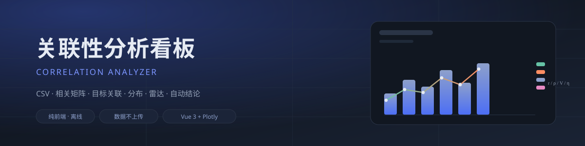

<div align="center">
  
</div>

<h1 align="center">Correlation Analyzer</h1>

<p align="center">
  <strong>Drop in a CSV and get a correlation matrix, target ranking, distributions, radar profiles and copy-ready insights.</strong><br>
  Pure frontend · Offline · No uploads · Vue 3 + Vite + Plotly
</p>

<p align="center">
  <a href="https://roslynmeow.github.io/CorrelationAnalyze/"></a>
  <a href="https://github.com/RoslynMeow/CorrelationAnalyze/actions/workflows/deploy.yml"></a>
  <a href="https://github.com/RoslynMeow/CorrelationAnalyze/actions/workflows/ci.yml"></a>
  <a href="./LICENSE"></a>
  <a href="https://github.com/users/RoslynMeow/projects/8"></a>
</p>

<p align="center"><a href="./README.md">简体中文</a> · <strong>English</strong></p>

---

## Live demo

**https://roslynmeow.github.io/CorrelationAnalyze/**

No install, no login, no upload. Any CSV works. To try it immediately, download the
[sample CSV](https://raw.githubusercontent.com/RoslynMeow/CorrelationAnalyze/main/tests/fixtures/sample.csv)
from the test fixtures.

## Features

| Tab | What it does |
| --- | --- |
| Overview | Dataset KPIs, top-10 association pairs, automatic summary |
| Matrix | Pearson / Spearman for numeric columns, Cramér's V for categorical ones |
| Target | Rank every column against a chosen target; r / ρ / η / V chosen automatically |
| Scatter | X/Y/color/size, linear fit, date axis |
| Group | Box plots for multiple numeric variables by any group |
| Pairs | SPLOM matrix, up to 6 dimensions, colored by category |
| Distribution | Histogram + KDE, optional group overlay, adjustable bins |
| Category | Countplot, stacked subgroups, percentage mode, imbalance ratio |
| Radar | Group profiles with Min-Max or Z-Score normalization |
| Insights | Data quality, strongest links, target drivers, redundancy |
| Data | Search, pagination, column profiles, CSV export |

Also included:

- Settings drawer: theme tokens, density, radius, shadow, table styles
- 4 palette presets + custom palette; per-chart and per-series colors
- Per-chart width/height, presets, drag-to-resize
- Copy chart image, download PNG / SVG, copy data as TSV, copy insights
- Import / export settings as JSON; everything persisted locally

## Statistics

| Columns | Measure |
| --- | --- |
| numeric × numeric | **Pearson r** (default) or **Spearman ρ** |
| numeric × categorical | **correlation ratio η** = √(SS_between / SS_total), 0–1 |
| categorical × categorical | **Cramér's V** (chi-square based), 0–1 |

Missing values are handled pairwise. The implementation lives in `src/lib/stats.ts` and is
validated against pandas / scipy with a 1e-9 tolerance.

## Quick start

Requires **Node.js ≥ 20.19**.

```bash
git clone https://github.com/RoslynMeow/CorrelationAnalyze.git
cd CorrelationAnalyze
npm install
npm run dev          # http://localhost:5188
npm test             # 53 tests
npm run build        # -> dist/
npm run build:single # -> dist-single/index.html (portable, offline)
```

The dev server uses port **5188** on purpose, to avoid clashing with other Vite projects.

## Project structure

```
src/
  App.vue            # tabs, drag & drop, settings drawer
  settings/          # settings schema, defaults, validation
  stores/            # dataset + settings (Pinia)
  lib/               # csv, infer, stats, chart theme, export
  workers/           # pairwise association worker
  components/        # PlotlyChart, SettingsDrawer, ...
  panels/            # 11 analysis tabs
tests/               # 53 tests + CSV fixture
.github/             # CI, Pages, issue/PR templates
```

## Testing

```bash
npm run typecheck
npm test
```

Covers statistics against pandas / scipy, CSV parsing and encodings, type inference,
and settings validation. Baseline examples:

| Metric | Value |
| --- | --- |
| Pearson r (stress_level × mental_health_index) | −0.974410393042 |
| Spearman ρ (same pair) | −0.946607341491 |
| η (stress_level grouped by risk_level) | 0.719637734744 |
| Cramér's V (gender × risk_level) | 0.183791360553 |

## Deployment

- `ci.yml` runs typecheck, tests and build on PRs / pushes
- `deploy.yml` builds `dist/` and publishes to GitHub Pages on `main`
- `base: './'` keeps every asset relative, so project pages and custom domains both work

## Roadmap

Full board: **https://github.com/users/RoslynMeow/projects/8**

- [x] CSV import: encodings, delimiters, type inference
- [x] r / ρ / V / η and target ranking
- [x] 11 analysis tabs
- [x] Appearance, palettes, per-chart sizes, export, settings JSON
- [x] Web Worker, GitHub Pages, single-file build
- [ ] Phase 2: editable UI text dictionary
- [ ] Phase 2: column / value display aliases
- [ ] Phase 2: per-file profiles
- [ ] Phase 3: per-chart title and axis title editing
- [ ] Phase 3: full-page report export

## Privacy

Files never leave the browser. All parsing, statistics and charting run locally; the app
works offline and offers a single-file build. Settings are stored in `localStorage` and can
be exported as JSON.

## Changelog

See [CHANGELOG.md](./CHANGELOG.md).

## License

[MIT](./LICENSE) © 2026 RoslynMeow
