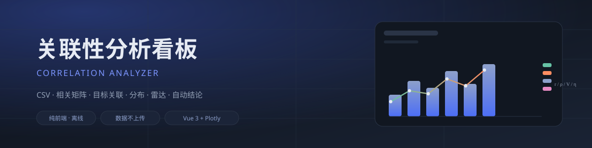

<div align="center">
  
</div>

<h1 align="center">关联性分析看板</h1>

<p align="center">
  <strong>拖入一个 CSV，立刻得到相关矩阵、目标关联、分布、雷达画像和可复制的文字结论。</strong><br>
  纯前端 · 可离线 · 数据不上传 · Vue 3 + Vite + Plotly
</p>

<p align="center">
  <a href="https://roslynmeow.github.io/CorrelationAnalyze/"></a>
  <a href="https://github.com/RoslynMeow/CorrelationAnalyze/actions/workflows/deploy.yml"></a>
  <a href="https://github.com/RoslynMeow/CorrelationAnalyze/actions/workflows/ci.yml"></a>
  <a href="./LICENSE"></a>
  <a href="https://github.com/users/RoslynMeow/projects/8"></a>
</p>

<p align="center">
  
  
  
  
  
</p>

<p align="center"><strong>简体中文</strong> · <a href="./README.en.md">English</a></p>

---

## 在线体验

**https://roslynmeow.github.io/CorrelationAnalyze/**

不需要安装、不需要登录、数据不会离开浏览器。准备任意 CSV 拖进去即可；想先试试可以下载仓库里的
[示例 CSV](https://raw.githubusercontent.com/RoslynMeow/CorrelationAnalyze/main/tests/fixtures/sample.csv)
（30 行 × 20 列，学生心理健康主题，仅用于测试，不随应用打包）。

## 功能

| 页签 | 内容 |
| --- | --- |
| 关联总览 | 数据规模 KPI、全部变量对的关联强度 Top 10、自动文字解读 |
| 相关矩阵 | 数值变量 Pearson / Spearman；类别变量 Cramér's V；下三角遮罩、数值标注、显著性星号 |
| 偏相关 / VIF | 控制最多 5 个变量（可折叠选择器，浮层展开不挤压图表）后的偏相关矩阵；数值列方差膨胀因子与共线性分级 |
| 目标关联 | 选一个目标列，其余列按关联强度排序；自动区分 r / ρ / η / V，附 p 值、95% CI 与 FDR 校正 |
| 散点拟合 | 任选 X / Y / 颜色 / 气泡大小；线性拟合（R²、斜率 CI、p 值）；日期列可作时间轴 |
| 分组对比 | 按任意分组列批量画箱线图，可多选数值变量 |
| 成对关系 | SPLOM 矩阵图，最多 6 维，按类别着色 |
| 分布分析 | 直方图 + KDE，可按组叠加上色，分箱数可调 |
| 类别计数 | countplot，可堆叠子组、切换百分比、显示不平衡比 |
| 雷达画像 | 按组标准化后的多维对比，Min-Max / Z-Score 两种标准化 |
| 分析结论 | 数据概况、最强关联、FDR 显著关联、目标因素、类别关联、冗余变量、数据质量 |
| 数据预览 | 表格分页、全列搜索、表头悬停 / 点按查看列画像、导出当前数据 CSV |

页签导航统一为下拉选择器（宽屏也一样），长文件名和窄窗口不会挤压页签。

### 全局行筛选

设置 → 操作 →「筛选数据」支持类别取值、数值范围与日期范围条件，多个条件为 AND。应用后统计、图表、数据预览和分享链接都只使用匹配的行；顶部横幅可随时修改或清除。

### 设置与自定义

顶栏只保留文件名和设置按钮，其余操作都收进设置抽屉：

- **操作**：筛选数据、预设模板、分享当前视图、更换 CSV
- **控制栏**：桌面端单行显示；多选变量折叠为一行浮层选择器，不额外占用高度
- **外观**：浅色 / 深色 / 跟随系统（默认跟随系统）、10 个颜色 token、圆角、密度、阴影
- **图表**：4 套色板预设 + 12 色自定义、热力图色阶、网格、透明背景、宽度上限、图例位置（底部 / 顶部 / 右侧 / 隐藏）
- **单图**：每张图独立的宽高、小/中/大预设、拖拽右下角实时缩放、图表标题/轴标题、逐序列配色；图本身可自由缩放，外层卡片始终占满剩余高度
- **表格**：表头背景、边框、字号、斑马纹
- **数据**：列显示名、类别取值显示名（例如 `mental_health_index → 心理健康指数`、`Low → 低`），按 CSV 表头自动保存
- **文案**：全部静态界面文案可搜索、逐条修改、恢复默认；修改立即生效
- **导出**：默认 PNG / SVG、PNG 1x/2x/3x
- **配置**：全局设置 + 按文件配置，导出 / 导入 JSON、恢复默认

### 导出与复制

每张图左上角工具条：**复制图片、下载 PNG、下载 SVG、复制数据（TSV）、重置缩放、图表设置**。
分析结论页提供「复制结论」。导出按当前显示尺寸生成，适合直接放进论文或演示材料。
设置 → 操作 →「分享当前视图」会把当前页签、视图选择与行筛选条件编码进链接，打开后载入同一份 CSV 即可复现。
设置 → 操作 →「预设模板」内置「自动推荐」「学生心理健康」模板，也可保存 / 导入 / 导出自定义预设。

> 复制图片需要 localhost 或 HTTPS；`file://` 下会自动回退为下载。
> WebGL 散点图导出 SVG 时会自动改为 PNG。

## 统计口径

| 变量组合 | 度量 |
| --- | --- |
| 数值 × 数值 | **Pearson r**（默认）或 **Spearman ρ**（平均秩后求 Pearson） |
| 数值 × 类别 | **相关比 η** = √(组间平方和 / 总平方和)，0–1，无方向 |
| 类别 × 类别 | **Cramér's V**（基于卡方），0–1，无方向 |

- 缺失值逐对剔除（pairwise complete）；r / ρ 需要 n ≥ 3，V 需要 n ≥ 4 且至少 2×2
- 常量列、ID 列不参与统计
- 有序等级自动识别：Low < Medium < High、低 < 中 < 高 等
- **p 值**：r / ρ 用 t 检验；V 用卡方检验；η 用 F 检验（单因素方差分析）
- **95% 置信区间**：r / ρ 经 Fisher z 变换；回归斜率用 t 分布
- **多重比较**：目标关联与全部变量对提供 Benjamini–Hochberg FDR 校正 q 值；矩阵星号为逐对未校正 p 值
- **偏相关**：对控制变量做标准化回归取残差后计算 r，p 值自由度为 n − 控制变量数 − 2
- **共线性**：VIF = 1 / (1 − R²)，由该列对其余数值列的标准化回归得到；VIF < 5 正常、5–10 需关注、>10 高共线
- **行筛选**：先按条件保留行，再做全部统计；类别条件按去空格后的原始取值精确匹配，数值 / 日期范围包含边界，缺失值默认排除
- 相关性不等于因果，样本量较小时请结合业务判断

实现集中在 `src/lib/stats.ts`，全部为纯函数，并有 pandas / scipy 对照测试（p 值、CI、R²、FDR 均有基准）。

## 快速开始

需要 **Node.js ≥ 20.19**（Vite 8 的要求）。

```bash
git clone https://github.com/RoslynMeow/CorrelationAnalyze.git
cd CorrelationAnalyze
npm install

npm run dev          # http://localhost:5188
npm test             # 101 个单元测试
npm run test:e2e     # Playwright 浏览器测试
npm run typecheck
npm run build        # 常规构建 -> dist/
npm run build:single # 单文件便携版 -> dist-single/index.html
npm run preview      # 预览构建产物 -> http://localhost:5188
npm run i18n:catalog # 新增 $t() 文案后重建文案词典
```

端口固定为 **5188**（`vite.config.ts` 的 `server.port` / `preview.port`，`strictPort: true`），
避免和本机其他项目的 5173 / 4173 冲突。

### 使用自己的数据

1. 打开应用，点击落地页卡片选择 CSV，或直接把文件拖进页面
2. 支持 `.csv` / `.tsv` / `.txt` 文本表格
3. 编码自动识别 UTF-8、UTF-8 BOM、GBK(GB18030)、UTF-16 LE/BE
4. 分隔符自动探测逗号、分号、Tab、竖线
5. 上限：读取前 100,000 行；散点抽样 6,000 点；SPLOM 抽样 3,000 行

### 单文件便携版

```bash
npm run build:single
```

产物是 `dist-single/index.html`（约 4.8 MB，内联 JS / CSS / Plotly / Web Worker），
双击即可运行，适合离线分发或放进 U 盘。

## 项目结构

```
CorrelationAnalyze/
├─ index.html
├─ package.json
├─ vite.config.ts
├─ vitest.config.ts
├─ src/
│  ├─ App.vue                  # 页签骨架 + 全局拖拽 + 设置抽屉
│  ├─ settings/
│  │  ├─ defaults.ts           # 配置模型、色板与默认值
│  │  ├─ merge.ts              # 配置校验 / 合并（纯函数）
│  │  └─ profiles.ts           # 按 CSV 表头保存的文件配置
│  ├─ presets/
│  │  ├─ types.ts              # 预设结构
│  │  ├─ builtin.ts            # 内置模板
│  │  └─ sanitize.ts           # 自定义预设校验
│  ├─ stores/
│  │  ├─ dataset.ts            # 数据 + 变量对缓存 + Worker 调用
│  │  ├─ settings.ts           # 外观 / 色板 / 尺寸 / 表格 / 文案 / 导出
│  │  ├─ view.ts               # 各面板当前选择（预设可整体套用）
│  │  └─ presets.ts            # 内置 / 自定义预设
│  ├─ i18n/
│  │  ├─ index.ts              # t() / 占位符替换
│  │  ├─ catalog.ts            # 自动生成的文案词典
│  │  └─ extra.ts              # 手动登记的文案键
│  ├─ lib/
│  │  ├─ csv.ts                # 解析 + 编码探测
│  │  ├─ infer.ts              # 类型 / ID / 分组列推断
│  │  ├─ stats.ts              # r / ρ / V / η / 回归 / KDE
│  │  ├─ associations.ts       # 变量对组合与缓存
│  │  ├─ chartTheme.ts         # Plotly 基础布局与主题联动
│  │  ├─ color.ts              # 颜色混合 / 色阶 / 透明度
│  │  ├─ exportChart.ts        # 图片 / SVG / TSV / 剪贴板
│  │  ├─ themeBus.ts           # 主题变化通知
│  │  └─ format.ts
│  ├─ workers/associations.worker.ts
│  ├─ components/              # PlotlyChart / SettingsDrawer / 图表工具条等
│  └─ panels/                  # 12 个页签
├─ tests/                      # 101 个单元测试 + fixtures/sample.csv（仅测试用）
├─ e2e/                        # Playwright 浏览器端测试
└─ .github/                    # CI、Pages、Issue/PR 模板
```

## 技术栈

| 层 | 选择 |
| --- | --- |
| 框架 | Vue 3（`<script setup>` + KeepAlive 页签缓存） |
| 构建 | Vite 8 + TypeScript + `vue-tsc` |
| 状态 | Pinia |
| 图表 | Plotly.js（热力图、SPLOM、雷达、箱线、日期轴、WebGL 散点） |
| 计算 | 纯 TypeScript，变量对放入 Web Worker |
| 测试 | Vitest + Playwright |
| 部署 | GitHub Actions + GitHub Pages；单文件版用 `vite-plugin-singlefile` |

## 测试

```bash
npm test        # 单元测试
npm run test:e2e # 浏览器端测试（首次需 npx playwright install chromium）
```

当前 **101 个单元测试 + 7 个 E2E 测试全部通过**：

- `tests/stats.spec.ts`：基础统计 + 与 pandas / scipy / statsmodels 对照（含 p 值、CI、R²、FDR、偏相关、VIF，容差 1e-9）
- `tests/csv.spec.ts`：引号、CRLF、BOM、重复列名、GB18030 / UTF-16
- `tests/infer.spec.ts`：类型推断、ID 列、分组列、有序等级、行数截断
- `tests/settings.spec.ts`：配置合并、非法值回退、颜色校验、尺寸限幅、JSON 往返
- `tests/profiles.spec.ts`：文件签名、按文件配置校验、颜色 / 尺寸 / 标题清洗
- `tests/i18n.spec.ts`：占位符替换、文案覆盖与恢复
- `tests/presets.spec.ts`：内置模板、列匹配、快照与导入校验
- `tests/share.spec.ts`：视图链接编码 / 解码、非法参数与字段清洗
- `tests/filter.spec.ts`：类别 / 数值 / 日期筛选、AND 组合、缺失值与子数据集统计
- `e2e/app.spec.ts`：载入 CSV、切换页签、矩阵星号、偏相关、行筛选、数据搜索/导出、PNG 下载、弹窗焦点与 Esc

对照基准示例：

| 指标 | 值 |
| --- | --- |
| Pearson r（stress_level × mental_health_index） | −0.974410393042 |
| Spearman ρ（同上） | −0.946607341491 |
| η（stress_level 按 risk_level 分组） | 0.719637734744 |
| Cramér's V（gender × risk_level） | 0.183791360553 |
| 回归斜率（sleep_hours → stress_level） | −0.330057856601 |
| Pearson p（stress_level × mental_health_index） | 1.08140841778e-19 |
| 95% CI（同上） | −0.987883158842 ~ −0.946361416480 |
| R²（sleep_hours → stress_level） | 0.0435836813004 |
| η 的 F 检验 p | 5.27974699208e-05 |
| Cramér's V 的卡方 p | 0.730837564067 |
| 偏相关（stress × mental_health，控制 sleep_hours） | −0.973479978414 |
| VIF（age） | 2.36285825544 |

## 部署

本仓库自带两个工作流：

- [`ci.yml`](./.github/workflows/ci.yml)：PR / push 时跑 typecheck、测试、构建
- [`deploy.yml`](./.github/workflows/deploy.yml)：推送到 `main` 时构建 `dist/` 并发布到 GitHub Pages

`vite.config.ts` 使用 `base: './'`，资源全部相对路径，因此项目页子路径（`/<repo>/`）和自定义域名都能直接工作。
首次部署只需在仓库 **Settings → Pages → Source** 选择 **GitHub Actions**。

## 路线图

完整看板：**https://github.com/users/RoslynMeow/projects/8**

- [x] CSV 自动编码 / 分隔符 / 类型推断
- [x] r / ρ / V / η 与目标关联
- [x] 12 个分析页签
- [x] 外观、色板、表格、单图尺寸/标题、导出与配置导入导出
- [x] Web Worker、GitHub Pages、单文件构建
- [x] 第 2 期：列名与类别取值显示映射
- [x] 第 2 期：按 CSV 文件保存列映射与图表配置
- [x] 第 2 期：全界面文案可编辑（i18n 词典）
- [x] 第 3 期：单图标题 / 轴标题编辑
- [x] 第 4 期：p 值 / 95% CI / R² / FDR 校正
- [x] 第 4 期：偏相关矩阵与 VIF 共线性检查
- [x] 第 4 期：视图链接分享（含筛选条件）
- [x] 第 5 期：全局行筛选（类别 / 数值 / 日期，AND 组合）
- [x] 常见数据集预设模板（自动推荐 / 心理健康 / 自定义）

## 数据与隐私

- 文件不会上传到任何服务器，全部计算在浏览器本地完成
- 断网可用；单文件版可以完全离线运行
- 分析结果只在当前页面内存在，刷新即清空（除用户主动保存的界面设置）
- 设置保存在 localStorage（`ca-settings-v1`），可通过导出 JSON 迁移

## 贡献

欢迎 Issue 和 PR。提交前请先看 [CONTRIBUTING.md](./CONTRIBUTING.md) 和
[路线图](https://github.com/users/RoslynMeow/projects/8)，避免重复工作。

- Bug：[新建 Issue](https://github.com/RoslynMeow/CorrelationAnalyze/issues/new/choose)，请附最小复现数据和浏览器信息
- 功能建议：请说明使用场景，而不只是实现方式
- 统计口径变更：必须同步更新 `tests/stats.spec.ts` 与 pandas / scipy 基准

## 更新日志

见 [CHANGELOG.md](./CHANGELOG.md)。

## License

[MIT](./LICENSE) © 2026 RoslynMeow
